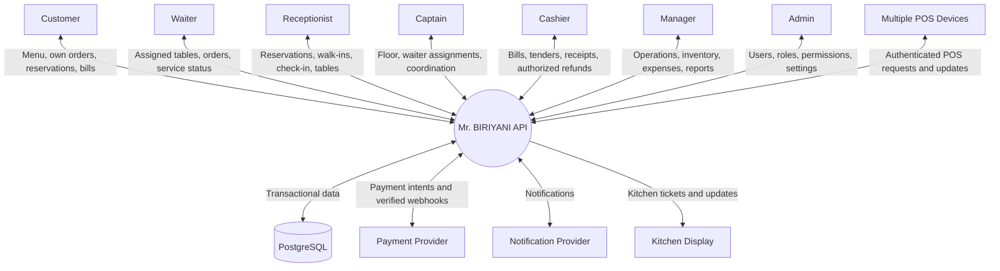
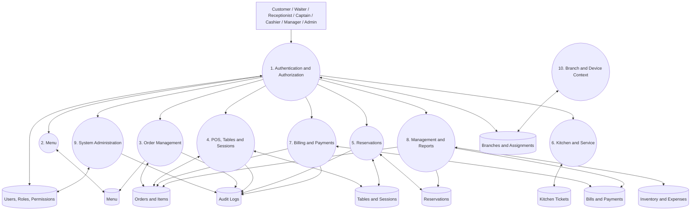
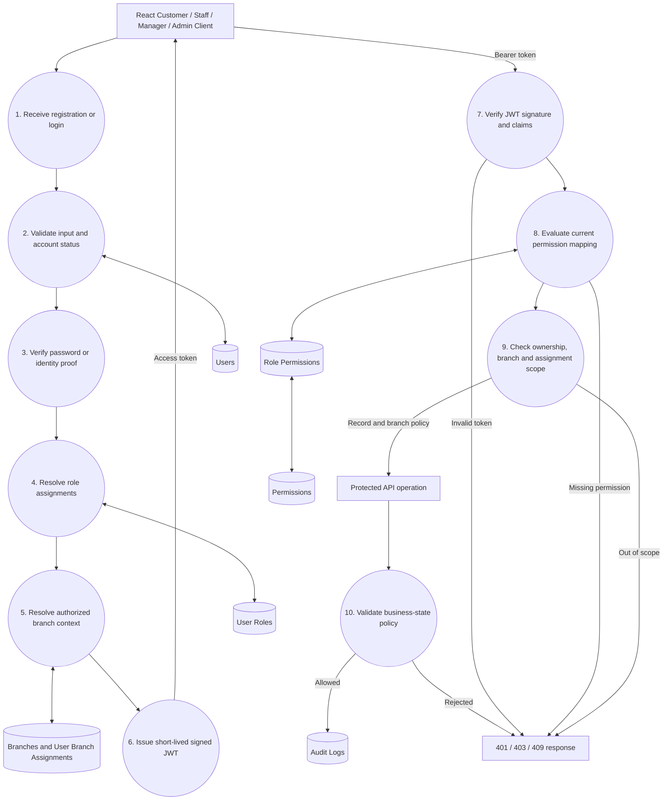
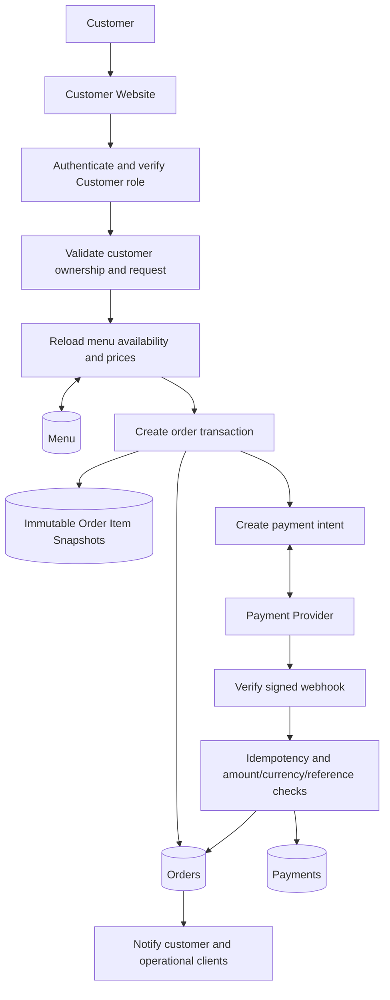
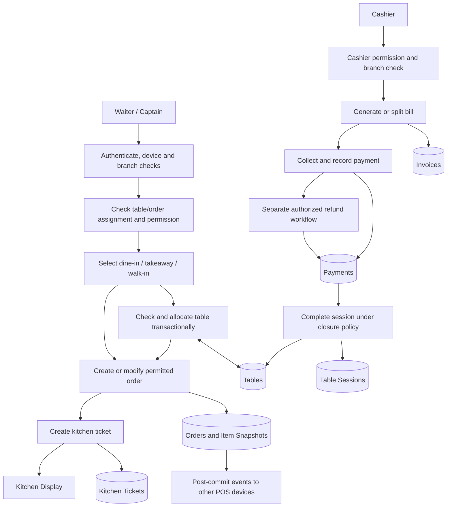
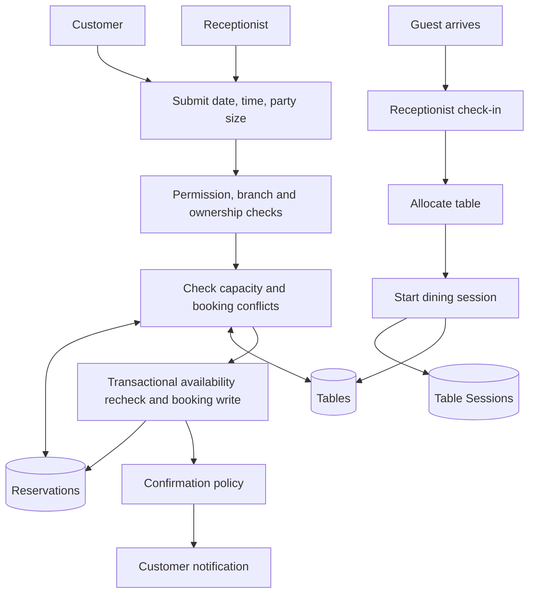
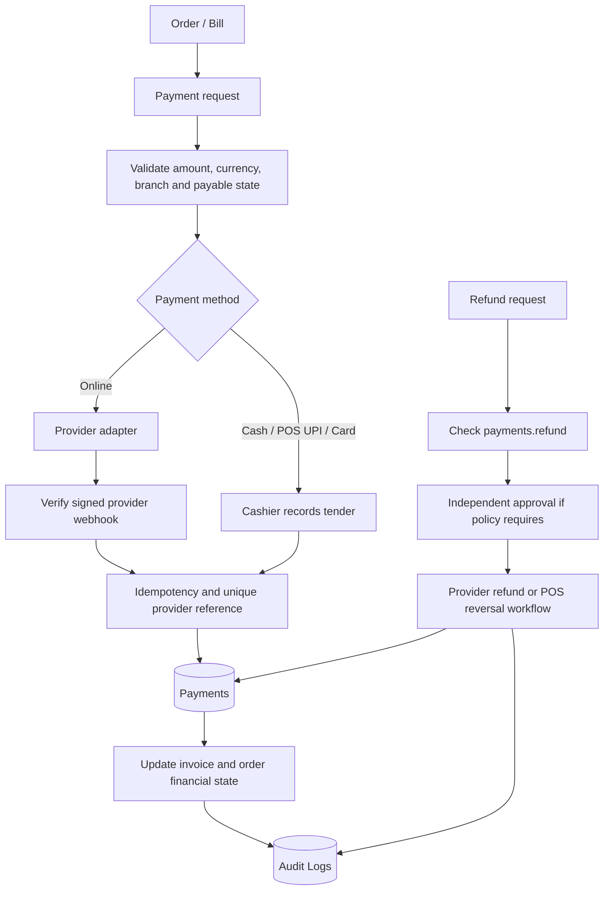
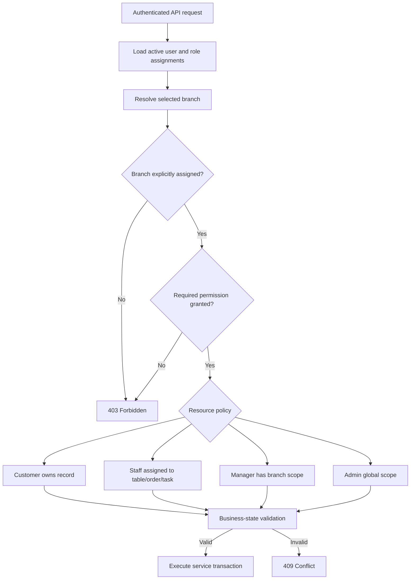
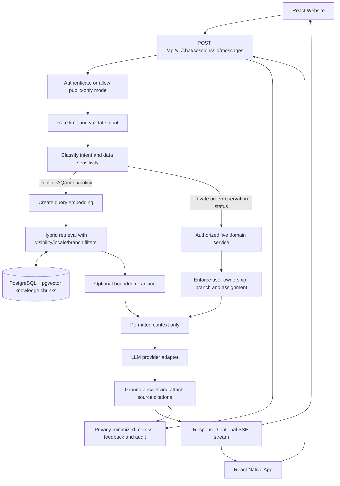
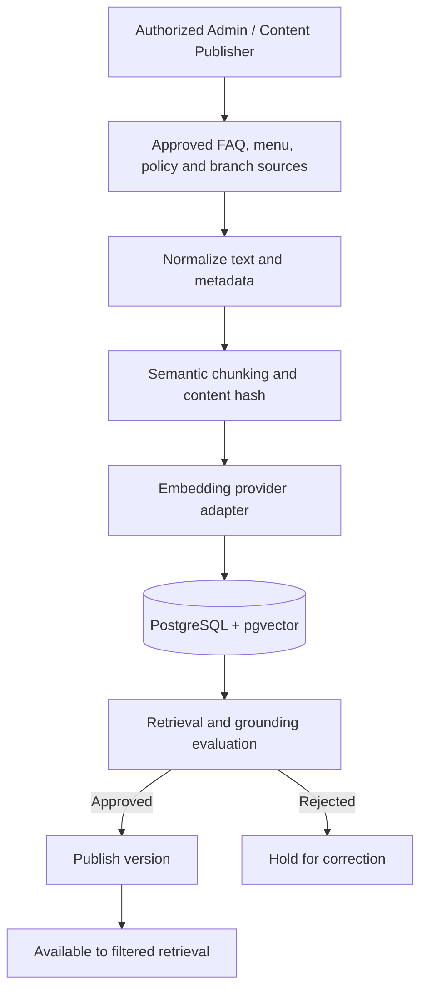

# Mr. BIRIYANI — Backend Data-Flow Diagrams

**Status:** Approved target architecture; diagrams describe planned flows, not implemented services or tables.

## Diagram index

1. [Level 0 — System context](#level-0--system-context)
2. [Level 1 — Backend processes](#level-1--backend-processes)
3. [Level 2 — Authentication and seven-role RBAC](#level-2--authentication-and-seven-role-rbac)
4. [Level 2 — Online customer order](#level-2--online-customer-order)
5. [Level 2 — Offline POS and billing](#level-2--offline-pos-and-billing)
6. [Level 2 — Reservation workflow](#level-2--reservation-workflow)
7. [Level 2 — Payment workflow](#level-2--payment-workflow)
8. [Level 2 — Branch and resource authorization](#level-2--branch-and-resource-authorization)
9. [Level 2 — RAG assistant query and ingestion](#level-2--rag-assistant-query-and-ingestion)

## Level 0 — System context

All clients use the API. PostgreSQL is the durable source of truth; browser state and WebSocket messages are not authoritative records.

## Level 1 — Backend processes

Every protected process passes authentication, permission evaluation, branch scope, resource ownership/assignment and business-state validation.

## Level 2 — Authentication and seven-role RBAC

### Seven standard roles

- CUSTOMER — own profile, orders, reservations and bills.
- WAITER — assigned tables, permitted order operations, kitchen dispatch and serving.
- RECEPTIONIST — reservations, check-in, walk-ins and table allocation.
- CAPTAIN — floor supervision, waiter assignment and service coordination.
- CASHIER — billing, split tenders, receipts and authorized refunds.
- MANAGER — operational staff, branch-scoped reports, inventory and expenses.
- ADMIN — user/role/permission administration, settings, integrations and security.

Public registration always assigns CUSTOMER. Admin may customize permission mappings for these seven protected predefined roles. Manager cannot edit role permissions or grant Admin.

## Level 2 — Online customer order

Client-submitted prices are never authoritative. Browser redirect is not proof of payment. Webhook processing is verified and idempotent.

## Level 2 — POS, table and billing workflow

Waiter/Captain order entry and Cashier billing/payment are separate capabilities. Do not expose a single generic POS screen as equivalent access for all staff roles.

## Level 2 — Reservation workflow

A confirmed reservation does not itself occupy a table. Actual occupancy starts with a dining session. Availability must be rechecked inside the booking transaction.

## Level 2 — Payment and refund workflow

Keep the payment provider behind an adapter. Razorpay, Zoho Payments and Cashfree remain candidates. Online gateway verification and offline tender recording are distinct flows.

## Level 2 — Branch and resource authorization

Global access is reserved for explicitly authorized Admin operations. Manager reports and staff management are branch-scoped. Waiter access is assignment-scoped. Customer records are ownership-scoped.

## Cross-cutting data-flow rules

- PostgreSQL is authoritative; browser storage and WebSocket events are not.
- Validate permissions and data scope on every protected request.
- Use server-calculated prices, discounts, tax and totals.
- Use transactions and concurrency controls for tables, reservations, inventory and payments.
- Use idempotency for retryable writes and gateway webhooks.
- Audit sensitive security, staff and financial changes.
- Persist state before publishing real-time events.
- Scope operational records and reports by branch.
- Do not log passwords, tokens, payment secrets or unnecessary personal data.

## Implementation order

1. Review the existing ER diagram and finalize relational schema.
2. Establish PostgreSQL/Prisma foundation and migrations.
3. Implement authentication and seven-role RBAC.
4. Implement branch, ownership and assignment policies.
5. Implement menu, customer and order modules.
6. Implement reservation, table, POS and kitchen workflows.
7. Separate Cashier billing/payment/refund operations.
8. Implement Manager reporting, inventory and expenses.
9. Integrate frontend role-aware workspaces and API authorization context.
10. Complete security, concurrency, integration and production-readiness tests.

## Level 2 — RAG assistant query and ingestion

**Planned flow only; no chatbot services or vector index are implemented yet.**

### Query flow

### Knowledge ingestion flow

### RAG safety boundaries

- Retrieved text is untrusted context, not executable instructions.
- Apply authorization filters before retrieval results reach the model; prompt wording is not an access-control mechanism.
- Private order/reservation data is fetched live through the domain service and owner-scoped, never from the general vector index.
- First release exposes no mutating tools. Model output cannot create orders, allocate tables, collect payments or issue refunds.
- Only approved, versioned sources can be published; deletions/expiry must deactivate stale chunks.
- Both clients use the same chat API and permission policy.
