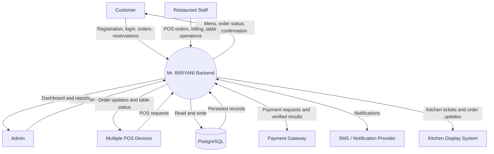
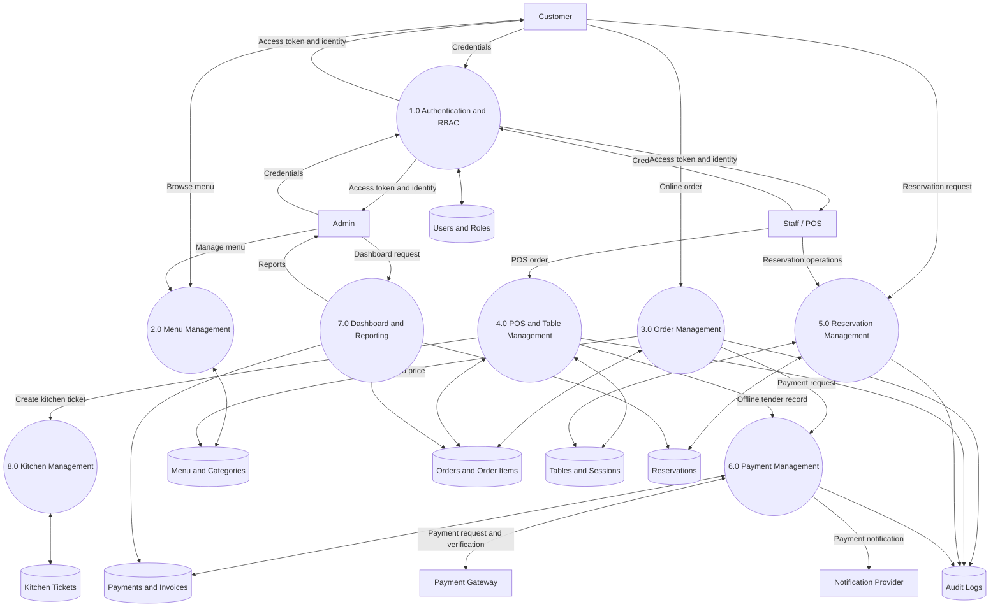
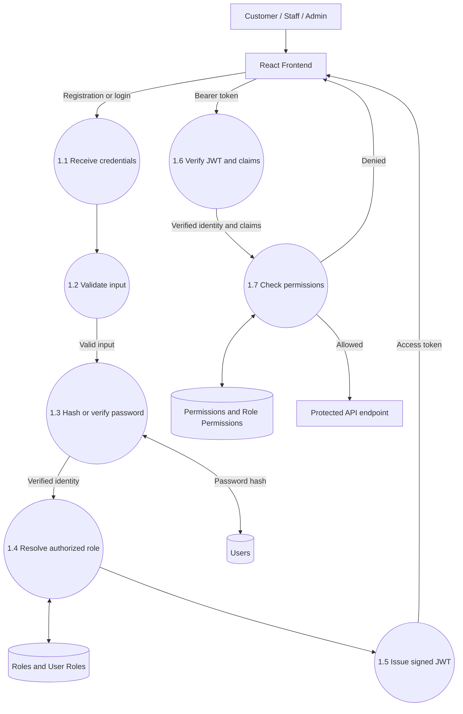
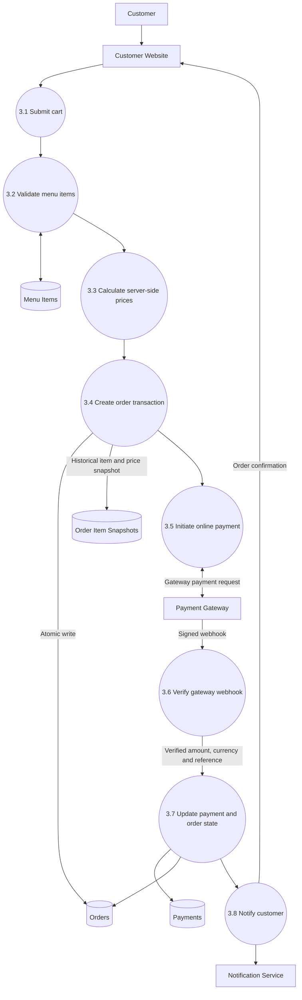
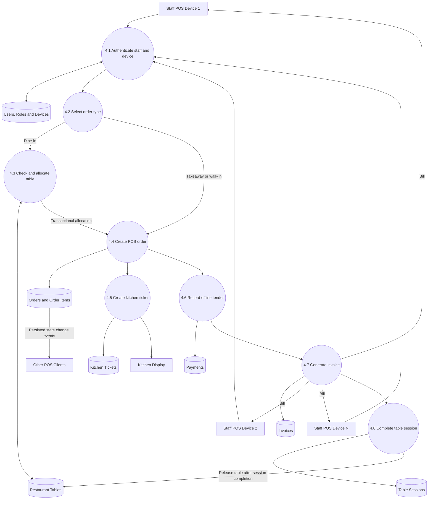
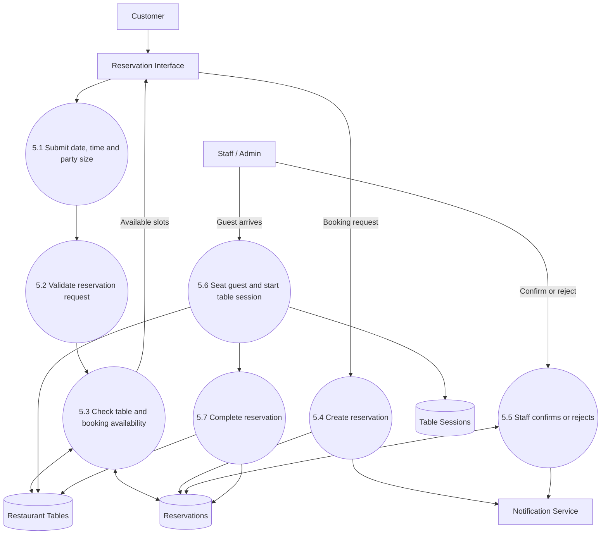
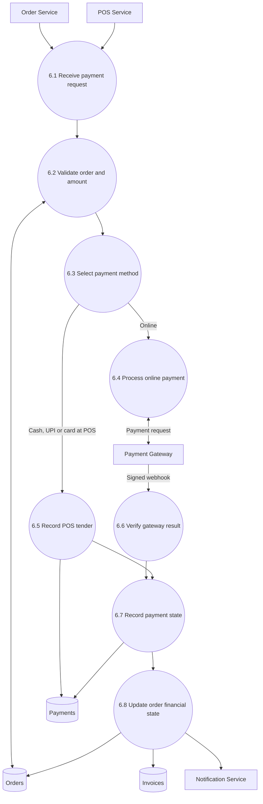

# Mr. BIRIYANI — Backend Data-Flow Diagrams

These Mermaid diagrams document the planned data movement through the Mr. BIRIYANI restaurant management backend. They are architecture documentation, not evidence of implemented services or database tables.

## Diagram index

1. [Level 0 — System context](#level-0--system-context)
2. [Level 1 — Backend processes](#level-1--backend-processes)
3. [Level 2 — Authentication and RBAC](#level-2--authentication-and-rbac)
4. [Level 2 — Online customer order](#level-2--online-customer-order)
5. [Level 2 — Offline POS and billing](#level-2--offline-pos-and-billing)
6. [Level 2 — Reservation workflow](#level-2--reservation-workflow)
7. [Level 2 — Payment workflow](#level-2--payment-workflow)

---

## Level 0 — System context

The backend is represented as one process interacting with external actors and providers.

**Data ownership:** PostgreSQL is the persistent source of truth. Frontend clients do not directly access the database.

## Level 1 — Backend processes

This decomposes the backend into its major functional processes and data stores.

Authentication and authorization are cross-cutting controls: every protected process must verify the caller's identity and permissions before performing an operation.

## Level 2 — Authentication and RBAC

**Controls:** Public registration assigns only the `customer` role. Staff/admin accounts are provisioned through an authorized process. JWT signature, algorithm, issuer, audience and expiry are verified. Client-supplied roles are never trusted.

## Level 2 — Online customer order

The frontend redirect is not proof of payment. The backend verifies the gateway webhook signature and transaction details before recording a successful payment. Webhook processing must be idempotent.

## Level 2 — Offline POS and billing

**Concurrency controls:** Use transactions and row-level locking or equivalent constraints for table allocation. Use idempotency keys for retried requests and unique constraints for invoice and payment references. WebSocket events notify other POS clients after the database transaction commits.

## Level 2 — Reservation workflow

Availability must be rechecked during the transactional write, not only during the earlier availability lookup. A confirmed reservation does not make a table occupied; the actual dining session does.

## Level 2 — Payment workflow

The payment service should expose a provider-neutral adapter interface. Provider selection (Razorpay, Zoho Payments or Cashfree) remains a separate commercial and technical decision. Offline tender records and online gateway transactions should share a consistent payment domain model without pretending they have identical verification flows.

---

## Cross-cutting data-flow rules

- **PostgreSQL is authoritative:** WebSocket messages are notifications, not durable records.
- **Server-calculated totals:** Never trust prices, discounts, taxes or totals supplied by a browser/POS client without server-side validation.
- **Atomic operations:** Orders, table allocation, inventory deductions and payment state changes require appropriate transactions and constraints.
- **Idempotency:** Design retry-safe order creation, payment initiation and webhook processing.
- **Auditability:** Record sensitive administrative and financial state changes with actor, action, target and timestamp.
- **Branch context:** Scope operational queries and authorization to the active branch once branch support is finalized.
- **Privacy:** Avoid placing secrets or unnecessary personal/payment data in tokens, events or logs.

## Implementation order

1. Verify the existing ER diagram and finalize the relational schema.
2. Establish backend foundation, PostgreSQL configuration and migrations.
3. Implement authentication and RBAC.
4. Implement menu and customer APIs.
5. Implement orders, POS, tables and billing.
6. Implement payment adapters and webhook verification.
7. Implement reservations and kitchen workflows.
8. Implement reporting, audit, tests and production operations.
